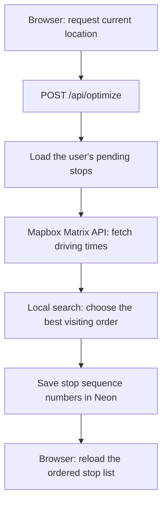

# Route Optimizer

[**Live Demo**](https://route-optimizer-d9qmf5duh-joshua-s-projects9.vercel.app)

A route-planning app for delivery and field service work. Users save stops, optimize their visiting order from their current location, and open individual stops in their phone's navigation app.

Mapbox provides driving-time estimates through its Matrix API. The application uses those estimates to calculate the best visiting order locally, then saves that order in Postgres.

## Features

- Email and password registration and login, with stops associated with each user's account.
- Address autocomplete and geocoding through Mapbox.
- Add, list, and delete stops.
- Optimize 2–11 pending stops, starting at the user's current location.
- Save the optimized order so it remains available after refreshing.
- Open a stop in Apple Maps on iOS or Google Maps on other devices.

## How route optimization works



1. The browser requests location permission and sends the current longitude and latitude to the optimization endpoint.
2. The server loads the authenticated user's pending stops in a stable order, using creation time and ID.
3. The server places the current location first in the coordinates array and makes **one Mapbox Matrix API request** for driving times between all locations.
4. A recursive search evaluates possible next stops. It caches results for each combination of current location and remaining stops to avoid repeating the same work.
5. The search chooses the order with the lowest total estimated driving time, visiting every pending stop once. The starting location is fixed; the final stop is chosen by the search. There is no return trip to the origin.
6. The server saves each job's sequence number, and the dashboard reloads the list.

The result is optimal for the supplied driving-time matrix and these constraints. It does not guarantee the fastest trip under changing road conditions. Travel times can be directional: driving from A to B may take a different amount of time than driving from B to A.

The service returns a **position for each input coordinate**, rather than an array of coordinates in visiting order. For example, `[0, 2, 1]` means the origin is position 0, the first supplied job is visited second, and the second supplied job is visited first. The API skips the origin when saving job positions.

### Design choices and limits

- The Matrix API supplies travel times; the application calculates the order. Mapbox Optimization v2 access is not required.
- The search has exponential growth despite caching, so the application caps optimization at 11 jobs plus the origin. The service supports one job, but the current API requires at least two pending jobs.
- The request uses `mapbox/driving`, without live traffic or departure-time modeling.
- Unreachable matrix entries are skipped. If no route visits every stop, optimization returns an error.
- Service durations, priorities, time windows, and vehicle capacity are not part of the optimization objective.
- Navigation opens one destination at a time. There is currently no in-browser map or full-route navigation handoff.

## Tech stack

| Area | Technology |
| --- | --- |
| Application | Next.js 16 App Router, React 19, TypeScript |
| Styling | Tailwind CSS 4 |
| Authentication | Auth.js v5 beta, credentials provider, JWT sessions, bcrypt password hashing |
| Database | Neon Postgres and Drizzle ORM |
| Validation | Zod |
| Location services | Browser Geolocation API, Mapbox Geocoding and Matrix APIs |
| Tests | Vitest |

## Using the app

1. Type an address, choose a suggestion, and add the stop.
2. Add between 2 and 11 stops for optimization.
3. Click **Optimize Route** and allow location access.
4. Review the reordered list. Refresh to confirm that the order was saved.
5. Click **Navigate** beside a stop to open directions in the device's navigation app.

Browser geolocation requires localhost or HTTPS and location permission. If a permission prompt does not appear, check the site's existing location permission and the operating system's location settings.

## Validation

| Command | Purpose |
| --- | --- |
| `npm run lint` | Run ESLint |
| `npx tsc --noEmit` | Check TypeScript types |
| `npx vitest run` | Run the existing tests once |

**Current test status:** the optimization tests still target the previous Mapbox Optimization API implementation. They need Matrix response mocks (`durations` instead of `waypoints`), a test token, and updated validation expectations before the suite can pass.

For a manual smoke test, register an account, add several stops, optimize with location access enabled, refresh, and confirm the order persists. Sign in with a second account to check that each account sees its own stops. Also check the error shown when location permission is denied.

## API overview

Except for registration and Auth.js authentication routes, these endpoints require a signed-in user.

| Method | Endpoint | Purpose |
| --- | --- | --- |
| `POST` | `/api/register` | Create an account with an email and password |
| `GET`, `POST` | `/api/auth/[...nextauth]` | Auth.js authentication handlers |
| `GET` | `/api/address-suggestions?q=...` | Find address suggestions |
| `POST` | `/api/geocode` | Convert an address to coordinates |
| `GET` | `/api/jobs` | List the current user's stops in sequence order |
| `POST` | `/api/jobs` | Create a stop with an address and coordinates |
| `DELETE` | `/api/jobs/:id` | Delete a stop belonging to the current user |
| `POST` | `/api/optimize` | Optimize and save the pending stop order |

The optimization request body has this shape:

```json
{
  "origin": {
    "longitude": -122.418563,
    "latitude": 37.751659
  }
}
```

On success it returns `{"ok": true}`. The client then fetches `/api/jobs` to retrieve the saved order.

## Project structure

```text
app/
  api/
    address-suggestions/  # Address autocomplete
    auth/[...nextauth]/   # Auth.js handlers
    geocode/              # Address-to-coordinate lookup
    jobs/                 # List, create, and delete stops
    optimize/             # Validate origin and save optimized positions
    register/             # Account registration
  login/page.tsx          # Login and registration UI
  page.tsx                # Stop management, location access, navigation
lib/
  auth/                   # Authentication and password hashing
  data/jobs.ts            # Database operations for stops
  db/                     # Drizzle client and schema
  services/optimize.ts    # Matrix request and cached route search
  services/optimize.test.ts
  validation.ts           # Shared request schemas
drizzle/                  # Generated SQL migrations and metadata
drizzle.config.ts         # Schema tooling configuration
proxy.ts                  # Auth.js route protection
```

To explore the implementation, start with [the dashboard](app/page.tsx), follow the request through [the optimization endpoint](app/api/optimize/route.ts), and review [the route search](lib/services/optimize.ts) and [job persistence](lib/data/jobs.ts).
